# Feature Specification: Akvo RAG Studio & Multi-Tenant Embeddable Widget Platform

> **Feature ID:** `024_feat_601_akvo_rag_studio_and_embeddable_widget_spec`
> **Task Ref:** `TASK-FEAT-601` (`[HACKATHON-PROPOSAL]`)
> **Target Branch:** `epic/rag-studio-widget`
> **Status:** `PROPOSED (Team Week Hackathon Spec)`
> **Estimated Effort:** `2.5 days (Hackathon Sprint)`
> **Author:** Galih Pratama / Antigravity AI Architect
> **Target Products:** `akvo-rag` (Core Backend & Frontend Studio) + `akvo-rag-js` (Embeddable Client)

---

## 1. Executive Summary & Problem Statement

### 1.1 The Challenge
Currently, Akvo builds separate, bespoke web portals and chatbots for individual donors and partners (e.g., IDH-IDC, NBD, SIWINS, ISCO, Eswatini). While `akvo-rag` provides powerful self-hosted retrieval capabilities and `akvo-rag-js` offers a client-side chat interface, deploying a custom chatbot to a partner website still requires:
1. **Manual developer intervention**: Hardcoding Knowledge Base IDs, WebSocket endpoints, and styling in JavaScript.
2. **Lack of Self-Service Branding**: No visual interface for partners to customize colors, bot personas, logos, and welcome greetings.
3. **Absence of Tenant Security & Governance**: No origin whitelisting or domain authorization to prevent unauthorized script scraping or token abuse.
4. **No Visibility/Analytics**: Partners cannot inspect user queries, top questions, unhandled topics, or satisfaction ratings.

### 1.2 The Solution: Akvo RAG Studio
**Akvo RAG Studio** transforms `akvo-rag` from an internal RAG engine into a **turnkey Multi-Tenant RAG-as-a-Service (RAGaaS) & No-Code Bot Builder**. 

With Akvo RAG Studio, any partner or internal project team can:
- Select and assign specific Knowledge Bases.
- Visually customize the chat widget (branding, colors, avatars, welcome greetings, and starter prompt suggestions) with a **Real-Time Live Preview**.
- Set up **Domain Whitelisting (CORS Security)**.
- Generate a **1-Click Embed Snippet** (`<script>`) that works on any website, CMS (WordPress, Drupal), or web application.
- Monitor usage and user insights via an **Analytics Dashboard**.

---

## 2. 5W1H Discovery Lens

| Dimension | Specification |
|---|---|
| **Who** | Akvo Project Managers, Partner Admins (non-technical & technical), Frontend Engineers, and End Users. |
| **What** | Build a No-Code Widget Studio inside `akvo-rag/frontend`, widget configuration and telemetry APIs in `akvo-rag/backend`, and lightweight config-resolution hooks in `akvo-rag-js`. |
| **Where** | `backend/app/models/widget.py`, `backend/app/api/v1/studio.py`, `frontend/src/pages/Studio/`, `frontend/src/components/WidgetPreview/`. |
| **When** | **Akvo Team Week Hackathon (2–3 Day Delivery Target)**. |
| **Why** | Solves donor customization bottlenecks, eliminates the need to create new frontend repos for basic QA portals, and enables commercial multi-tenant SaaS packaging. |
| **How** | FastAPI CRUD & public config resolver, PostgreSQL/SQLAlchemy metadata storage, React/Tailwind visual customizer with live iframe/sandbox preview, and CDN-backed `akvo-rag-js` injection. |

---

## 3. System Architecture & Component Design

```
┌────────────────────────────────────────────────────────────────────────┐
│                        Akvo RAG Studio (Frontend)                     │
│  ┌───────────────────────────┐      ┌───────────────────────────────┐  │
│  │    Theme & KB Controls    │ ───> │     Live Widget Preview       │  │
│  │ (Color, Logo, Prompt, KB) │      │   (Real-time CSS/JS sandbox)  │  │
│  └─────────────┬─────────────┘      └───────────────────────────────┘  │
│                │ Save Config                                           │
└────────────────┼───────────────────────────────────────────────────────┘
                 │
                 ▼
┌────────────────────────────────────────────────────────────────────────┐
│                      Akvo RAG Backend (FastAPI)                        │
│  ┌───────────────────────────┐      ┌───────────────────────────────┐  │
│  │   /api/v1/studio/widgets  │      │ /api/v1/public/widget/{key}   │  │
│  │   (Tenant Authenticated)  │      │ (Origin-Validated Public API) │  │
│  └─────────────┬─────────────┘      └───────────────▲───────────────┘  │
│                │                                    │                  │
│                ▼                                    │                  │
│      ┌──────────────────┐                           │                  │
│      │ PostgreSQL DB    │ ──────────────────────────┘                  │
│      │ (widgets table)  │                                              │
│      └──────────────────┘                                              │
└─────────────────────────────────────────────────────┬──────────────────┘
                                                      │
                                                      │ Script Embed
                                                      ▼
┌────────────────────────────────────────────────────────────────────────┐
│                 Partner Website (e.g., partner-ngo.org)                │
│  <script src="https://cdn.jsdelivr.net/.../akvo-rag.js"></script>      │
│  <script>AkvoRAG.init({ widgetKey: "wgt_98ab71c2..." });</script>     │
└────────────────────────────────────────────────────────────────────────┘
```

---

## 4. Technical Specifications

### 4.1 Database Schema (`backend/app/models/widget.py`)

```python
import uuid
from sqlalchemy import Column, String, Boolean, JSON, ForeignKey, DateTime
from sqlalchemy.dialects.postgresql import UUID
from sqlalchemy.sql import func
from app.db.base_class import Base

class WidgetConfig(Base):
    __tablename__ = "widget_configs"

    id = Column(UUID(as_uuid=True), primary_key=True, default=uuid.uuid4)
    widget_key = Column(String(64), unique=True, index=True, nullable=False)
    name = Column(String(255), nullable=False)
    user_id = Column(UUID(as_uuid=True), ForeignKey("users.id"), nullable=False)
    
    # Knowledge Base Association
    kb_ids = Column(JSON, default=list, nullable=False) # List of KB IDs: [1, 5]
    
    # Security / Whitelist
    allowed_domains = Column(JSON, default=list, nullable=False) # ["partner.org", "localhost"]
    is_active = Column(Boolean, default=True, nullable=False)
    
    # Visual Theme & Persona Customization
    theme = Column(JSON, default=lambda: {
        "primary_color": "#009688",
        "secondary_color": "#E0F2F1",
        "bot_name": "Akvo Assistant",
        "bot_avatar_url": "",
        "welcome_message": "Hello! How can I help you today?",
        "suggested_prompts": [
            "What is this project about?",
            "How can I submit a report?"
        ],
        "position": "bottom-right", # bottom-right | bottom-left
        "enable_citations": True,
        "enable_feedback": True
    }, nullable=False)
    
    created_at = Column(DateTime(timezone=True), server_default=func.now())
    updated_at = Column(DateTime(timezone=True), onupdate=func.now())
```

### 4.2 Backend API Endpoints

#### 1. Tenant Admin Endpoints (`/api/v1/studio/widgets`)
* `GET /api/v1/studio/widgets` - List all widgets created by the tenant.
* `POST /api/v1/studio/widgets` - Create a new widget configuration.
* `GET /api/v1/studio/widgets/{id}` - Get full widget configuration.
* `PUT /api/v1/studio/widgets/{id}` - Update theme, domains, or KB associations.
* `DELETE /api/v1/studio/widgets/{id}` - Archive/Deactivate widget.

#### 2. Public Client Resolver (`/api/v1/public/widgets/{widget_key}/config`)
* **Auth**: None (Public, validated via HTTP `Origin` or `Referer` header against `allowed_domains`).
* **Response**:
```json
{
  "widget_key": "wgt_98ab71c2",
  "bot_name": "WASH Advisory Bot",
  "theme": {
    "primary_color": "#0F766E",
    "bot_avatar_url": "https://assets.akvo.org/logo.png",
    "welcome_message": "Welcome! Ask me anything about water quality guidelines.",
    "suggested_prompts": ["Chlorination guidelines", "Water test kits"]
  },
  "ws_url": "wss://rag.akvo.org/ws/chat",
  "kb_ids": [12]
}
```

---

## 5. Frontend UI: Widget Studio (`akvo-rag/frontend`)

The new Studio interface is structured into three clear panes:

1. **Setup & General Info**:
   - Widget Name & Description.
   - Knowledge Base selector (multi-select from tenant's indexed KBs).
   - Domain whitelisting input tags.
2. **Visual Customizer**:
   - Color picker for brand identity (Primary, Bubble, Text colors).
   - Bot Identity (Bot Name, Avatar upload/URL).
   - Chat Greeting & Starter Questions (Pills).
   - Widget launcher position & icon style.
3. **Live Sandbox Preview**:
   - An interactive, live preview container rendering the actual `akvo-rag-js` component.
   - Changes made in the customizer reflect immediately in real-time.
4. **Export & Embed Modal**:
   - 1-Click HTML script generator.
   - React / NPM integration code snippet.
   - Direct shareable standalone link (for testing or sharing with non-technical stakeholders).

---

## 6. Hackathon Delivery Roadmap (2-3 Day Sprint)

```mermaid
flowchart LR
    subgraph Day 1: Foundation
        D1A[Backend: Widget Model & Alembic Migration]
        D1B[Backend: CRUD & Public Config API]
    end
    
    subgraph Day 2: Studio UI & Integration
        D2A[Frontend: Studio Page & Live Customizer]
        D2B[Frontend: Dynamic Preview & Embed Modal]
        D2C[Client: akvo-rag-js initWidget Hook]
    end
    
    subgraph Day 3: Polish & Demo
        D3A[Domain Whitelisting Security Check]
        D3B[E2E Demo on Dummy Partner Website]
        D3C[Pitch Deck & Live Demo Presentation]
    end

    D1A --> D1B --> D2A --> D2B --> D2C --> D3A --> D3B --> D3C
```



---

## 7. Business & Commercial Impact for Akvo

1. **Instant Partner Time-to-Market**: Deploy an interactive, AI-powered QA assistant on any partner website in **under 3 minutes** instead of starting a new software project.
2. **High-Margin Multi-Tenant Add-on**: Positioned as a plug-and-play SaaS add-on for existing Akvo MIS partners or new donor programs.
3. **Unified Brand & Tech Stack**: Reuses existing core investments (`akvo-rag`, `vector-kb-mcp`, `akvo-rag-js`) without creating technical fragmentation.
