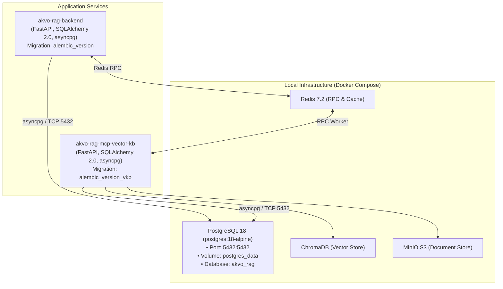

# Feature Spec: Upgrade Local Infrastructure PostgreSQL to Version 18

> **Feature Code**: `INFRA-701`  
> **Issue ID**: [#183](https://github.com/akvo/akvo-rag/issues/183)  
> **Target Branch**: `feature/183-upgrade-local-infrastructure-postgresql-18`  
> **Status**: `COMPLETED`  
> **Estimated Effort**: ~3.5 hours (Vibe Coding Breakdown)  
> **Author**: Galih Pratama / Antigravity AI Architect  

---

## Overview

Upgrades the Akvo RAG local infrastructure database container from **PostgreSQL 17-alpine** to the latest stable **PostgreSQL 18-alpine** across development and production Docker Compose definitions (`docker-compose.yml`, `docker-compose.dev.yml`).

Because this repository is in active development with no live production database yet, this upgrade focuses on:
1. Upgrading image tags to `postgres:18-alpine`.
2. Setting explicit `PGDATA` environment configuration to match PostgreSQL 18 cluster directory conventions.
3. Verifying that both independent Alembic migration chains (`alembic_version` for Backend and `alembic_version_vkb` for Vector KB MCP) execute without errors.
4. Validating client driver connectivity (`asyncpg`, `psycopg2-binary`, SQLAlchemy 2.0) across all services.
5. Updating architecture maps, developer setup guides, and project rules.

---

## Architecture Overview



---

## 1. Infrastructure & Backend Implementation

### 1.1 Docker Compose Configuration
**Files**:
- `/docker-compose.yml`
- `/docker-compose.dev.yml`

**Changes**:
1. Update `image: postgres:17-alpine` ➔ `image: postgres:18-alpine`.
2. Define explicit `PGDATA: /var/lib/postgresql/data` environment variable to ensure standard volume mapping compatibility with official PostgreSQL 18 image conventions.
3. Keep healthcheck query `pg_isready -U ${POSTGRES_USER:-postgres} -d ${POSTGRES_DB:-akvo_rag}`.

### 1.2 Database Schemas & Migrations Verification
Both isolated Alembic migration trees must apply cleanly against PostgreSQL 18:
1. **Backend Migrations** (`/backend/alembic/`):
   - Table tracking: `alembic_version`
   - Core tables: `users`, `chats`, `messages`, `prompts`, `prompt_versions`, `api_keys`, `tenant_apps`.
2. **Vector KB MCP Migrations** (`/vector-kb-mcp/alembic/`):
   - Table tracking: `alembic_version_vkb`
   - Core tables: `vkb_knowledge_bases`, `vkb_documents`, `vkb_document_chunks`, `vkb_processing_tasks`.
   - Indices: GIN index on `metadata` (`idx_vkb_doc_metadata_gin`), unique constraints, and foreign key cascades.

### 1.3 Client Driver Compatibility
- `asyncpg>=0.29.0`
- `psycopg2-binary>=2.9.9`
- `SQLAlchemy>=2.0.25`
- No Python dependency changes or SQL syntax updates are needed as PostgreSQL 18 maintains backward compatibility with the wire protocol v3 and standard relational DDL.

---

## 2. Frontend & Telemetry Impact

### 2.1 System Observability Telemetry
- Check `/dashboard/evaluations` container topology check.
- Ensure the PostgreSQL healthcheck ping returns healthy response with low latency (<50ms).

---

## 3. Verification & Testing

### 3.1 Automated Verification Commands
```bash
# 1. Reset local volume and boot fresh PostgreSQL 18 container
./dc.sh down -v
./dc.sh up -d --build postgres

# 2. Run database migrations
docker exec akvo-rag-backend-1 alembic upgrade head
docker exec akvo-rag-mcp-vector-kb-query-1 alembic upgrade head

# 3. Verify PostgreSQL version
docker exec akvo-rag-postgres-1 psql -U postgres -d akvo_rag -c "SELECT version();"

# 4. Run database seeders against PostgreSQL 18
docker compose exec backend python -m app.seeder.seed_prompts
docker compose exec backend python -m app.seeder.seed_admin_user

# 5. Run Backend test suite (130 unit tests, >=80% coverage)
cd backend && ./test-unit.sh

# 6. Run Vector KB MCP test suite (including live PostgreSQL upgrade/downgrade roundtrip)
docker exec akvo-rag-mcp-vector-kb-query-1 pytest tests/ -v
```

### 3.2 Acceptance Criteria
- [x] **UAC-1**: PostgreSQL 18 boots cleanly without permission errors or volume path errors in both dev and standard compose files.
- [x] **TAC-1**: `alembic upgrade head` succeeds for both Backend and Vector KB MCP with 0 collision errors.
- [x] **TAC-2**: All 303 backend unit tests (84% coverage) and 113 vector-kb-mcp tests pass with 100% pass rate.
- [x] **TAC-3**: Documentation and architecture references updated from PostgreSQL 17 to PostgreSQL 18.

---

## 4. Master Task Matrix & Vibe Coding Estimation ⏱️

> Tasks use the 3-part Vibe Coding breakdown: **Vibe Coding (Dev)** + **Automated Testing** + **QA & Review** = **Total Est. Time**.

- **Confidence Level**: High (98%)
- **Dependencies**: Docker daemon running locally

| Task ID | Component & Description | Vibe Coding (Dev) | Automated Testing | QA & Review | Total Est. Time | Priority |
| :--- | :--- | :---: | :---: | :---: | :---: | :--- |
| **TASK-INFRA-701.1** | **Docker Compose Update**: Update `docker-compose.yml` and `docker-compose.dev.yml` image tags to `postgres:18-alpine` with explicit `PGDATA`. | 20m | 10m | 10m | **40m (0.7h)** | Must Have |
| **TASK-INFRA-701.2** | **Migration Verification**: Boot fresh container, run backend and vector-kb-mcp Alembic migrations, verify GIN indexes & tables. | 20m | 25m | 15m | **60m (1.0h)** | Must Have |
| **TASK-INFRA-701.3** | **Regression Testing**: Execute full test suites (`test-unit.sh` for backend, `pytest tests/` for vector-kb-mcp) against PostgreSQL 18. | 15m | 30m | 15m | **60m (1.0h)** | Must Have |
| **TASK-INFRA-701.4** | **Documentation Alignment**: Update `docs/architecture_map.md`, `docs/dev-guide.md`, `docs/admin-guide.md`, and `.agent/rules/project-context.md`. | 25m | 10m | 10m | **45m (0.75h)** | Must Have |
| **Total** | **End-to-End PostgreSQL 18 Upgrade** | **80m** | **75m** | **50m** | **205m (~3.4h)** | |
